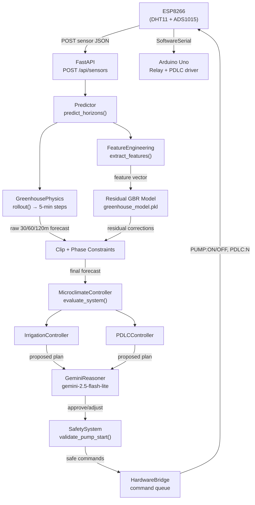

# AGROVYN Backend — ML Model & Agent Documentation

> Technical reference for the forecasting engine and autonomous control agent that power the AGROVYN smart greenhouse.

---

## Table of Contents

1. [Architecture Overview](#1-architecture-overview)
2. [ML Forecasting Engine](#2-ml-forecasting-engine)
   - [Physics Model](#21-physics-model-greenhousephysics)
   - [Feature Engineering](#22-feature-engineering)
   - [Residual ML Model](#23-residual-ml-model-gradient-boosting)
   - [Predictor — Putting It Together](#24-predictor--putting-it-together)
3. [Autonomous Agent](#3-autonomous-agent)
   - [GreenhouseAgent Loop](#31-greenhouseagent-loop)
   - [MicroclimateController — Rule Engine](#32-microclimatecontroller--rule-engine)
   - [Gemini Reasoner — LLM Layer](#33-gemini-reasoner--llm-layer)
   - [SafetySystem — Hard Limits](#34-safetysystem--hard-limits)
4. [Control Outputs](#4-control-outputs)
   - [Irrigation (Pump)](#41-irrigation-pump)
   - [PDLC Smart Glass](#42-pdlc-smart-glass)
5. [Data Flow Diagram](#5-data-flow-diagram)
6. [File Reference](#6-file-reference)

---

## 1. Architecture Overview

The backend uses a **3-layer architecture** to go from raw sensor data to physical actuator commands:

```
ESP8266 Sensors
      │
      ▼
 FastAPI Layer  ──── POST /api/sensors
      │
      ▼
 GreenhouseAgent.run_cycle()
   ├── Predictor            (Physics + ML → 30 / 60 / 120-min forecasts)
   ├── MicroclimateController  (Rule engine → proposed pump + PDLC)
   ├── GeminiReasoner       (LLM review → approve / adjust / veto)
   └── SafetySystem         (Hard limits → final gate before actuation)
      │
      ▼
 HardwareBridge  ──── command queue ──── ESP8266 (PUMP:ON, PDLC:66, …)
```

The **physics model is always the primary forecaster**. The ML model, when present, adds only a small **residual correction** on top. The Gemini LLM layer may adjust or veto proposals but can never bypass the `SafetySystem`.

---

## 2. ML Forecasting Engine

The forecasting engine lives in `app/ml/` and is composed of three cooperating components.

### 2.1 Physics Model (`GreenhousePhysics`)

**File:** [`app/ml/physics_model.py`](app/ml/physics_model.py)

This is a first-principles **energy-balance / evapotranspiration model** calibrated for Bangalore (latitude 12.97° N). It simulates the greenhouse microclimate step-by-step using real atmospheric physics, rather than relying purely on historical data patterns.

#### Key Sub-Models

| Sub-model | What it computes |
|---|---|
| `solar_elevation_deg()` | Sun's angle above the horizon at any time of day / day of year using declination + hour angle geometry |
| `clear_sky_light_pct()` | Theoretical clear-sky irradiance (0–100%) from the solar elevation with an air-mass damping factor |
| `effective_solar_light()` | Blends the LDR sensor reading with solar geometry to filter out non-solar noise at night |
| `outdoor_temperature()` | Diurnal outdoor air temperature curve: mean 24.5°C, amplitude ±6.8°C, peak at 15:00 |
| `GreenhousePhysics.step()` | One time-step of the energy balance (see below) |

#### Energy Balance Step (`step()`)

Each 5-minute step advances four state variables:

**Temperature**
$$T_{n+1} = T_n + \alpha \cdot (T_{eq} - T_n)$$

Where:
- $T_{eq} = T_{outdoor} + 0.14 \cdot I_{solar} \cdot (1 - 0.55 \cdot \text{PDLC}) - \text{humidity correction}$ — the equilibrium temperature given current irradiance and shade
- $\alpha = 1 - e^{-\Delta t / \tau}$, $\tau = 70$ min — thermal inertia time constant of the greenhouse envelope

**Soil Moisture**
Evapotranspiration (ET) is computed each step and subtracted from soil moisture:
$$ET = \Delta t_{hours} \cdot (0.28 + 0.045 \cdot \max(T-16, 0) + 0.022 \cdot I_{solar}) \cdot (1.2 - RH/250)$$

When the irrigation pump is ON, soil moisture gains `+6.5% per hour × 12` (fast wicking rate).

**Humidity**
Equilibrium RH is derived from temperature and soil moisture:
$$RH_{eq} = 78 - 0.85(T - 18) + 0.12(\text{soil} - 45)$$
RH relaxes towards $RH_{eq}$ with a 28% step factor per 5-minute tick.

**Light**
Future light is predicted by carrying forward the current cloud-cover fraction (LDR / clear-sky) and applying it to the next period's clear-sky model.

#### Rollout & Phase Constraints

`rollout()` chains `step()` calls for up to 120 minutes, capturing snapshots at the requested horizons (30 / 60 / 120 min).

`apply_phase_constraints()` then enforces hard physical guardrails:
- After 16:30 local time, temperature **cannot keep rising** (sun declining)
- After sunset (solar elevation ≤ 0), temperature must **fall**, not rise
- Light forecast **cannot increase** if the sun is declining
- Soil moisture **cannot increase** in an open-loop forecast (pump not assumed on)

---

### 2.2 Feature Engineering

**File:** [`app/ml/feature_engineering.py`](app/ml/feature_engineering.py)

`FeatureEngineering.extract_features()` builds the feature vector that the residual ML model expects. It automatically detects which schema version the loaded model was trained on and returns the matching shape.

#### Feature Schemas

| Schema | Features (n) | Used when |
|---|---|---|
| **V1 (Legacy)** | `temperature, humidity, soil_moisture, light, sin_hour, cos_hour` | Model `.pkl` trained on 6 features |
| **V2 (Full)** | All V1 features + `solar_elevation, clear_sky_light, effective_light, is_day` | Model `.pkl` trained on 10 features |

The cyclic time features `sin_hour` and `cos_hour` encode the time-of-day as a continuous circular variable (avoids the discontinuity at midnight that raw hour values would cause).

---

### 2.3 Residual ML Model (Gradient Boosting)

**File:** [`app/ml/model_loader.py`](app/ml/model_loader.py) · **Model artifact:** `models/greenhouse_model.pkl`

The trained model is loaded once at startup via a **singleton** `ModelLoader`. The `.pkl` file contains:

```python
{
    "model":         <sklearn GradientBoostingRegressor>,
    "feature_names": [...],   # list of feature names the model expects
    "version":       "PhysicsHybrid-ResidualGBR-v2.0.0",
    "metrics":       { "mae": ..., "r2": ..., ... }
}
```

If the `.pkl` file is not found, the system **gracefully falls back to pure physics** — the model is optional, not required.

The model's output is a **residual correction vector** (not an absolute prediction). It predicts the error that the physics model makes for each of the four sensor channels across the three forecast horizons (12 outputs total: 4 sensors × 3 horizons).

---

### 2.4 Predictor — Putting It Together

**File:** [`app/ml/predictor.py`](app/ml/predictor.py)  
**Class:** `Predictor`

`predict_horizons()` is the single public method. Here is the full pipeline:

```
1. Parse timestamp → datetime (fallback to now() if stale > 20 min)
2. Physics rollout → raw forecasts at 30, 60, 120 min
3. Residual ML → correction vector (skipped if model absent)
4. Clip residuals per-channel:
       temperature  ±1.2°C  (×scale for longer horizons)
       humidity     ±4.0%
       soil_moisture ±3.5%
       light        ±8.0%
5. Apply phase constraints (solar guardrails)
6. Return structured forecast dict
```

**Confidence score:** Base 0.82 (with ML) or 0.78 (physics-only), +0.04 bonus at night (night physics is more deterministic than daytime weather), capped at 0.93.

#### Sample Output

```json
{
  "engine": "physics-hybrid",
  "model_version": "PhysicsHybrid-ResidualGBR-v2.0.0",
  "confidence": 0.86,
  "horizon_30m":  { "temperature": 29.4, "humidity": 65.2, "soil_moisture": 51.3, "light": 72.1 },
  "horizon_60m":  { "temperature": 30.1, "humidity": 63.8, "soil_moisture": 48.7, "light": 68.4 },
  "horizon_120m": { "temperature": 31.2, "humidity": 61.0, "soil_moisture": 43.2, "light": 55.9 },
  "diagnostics": {
    "hour": 13.45,
    "solar_elevation_deg": 62.3,
    "clear_sky_light_pct": 89.1,
    "effective_light_pct": 74.6,
    "used_residual_ml": true
  }
}
```

---

## 3. Autonomous Agent

The agent layer lives in `app/agent/` and orchestrates the full observe → forecast → decide → actuate loop.

### 3.1 GreenhouseAgent Loop

**File:** [`app/agent/greenhouse_agent.py`](app/agent/greenhouse_agent.py)  
**Method:** `run_cycle(reading, actuator_state, execute=True)`

`run_cycle()` is called every time a new sensor reading arrives. The loop has four stages:

```
Stage 1 — Observe & Forecast
  Predictor.predict_horizons() → 30/60/120-min forecast

Stage 2 — Rules Proposal
  MicroclimateController.evaluate_system() → proposed pump (ON/OFF) + PDLC (0/33/66/100)
  Night override: if solar elevation ≤ 0, PDLC is forced to 0 (clear)

Stage 3 — Gemini Review (optional)
  GeminiReasoner.reason(snapshot) → approve / adjust / veto
  Gemini may ONLY turn pump OFF (more conservative) — it can NEVER force pump ON
  Gemini may adjust PDLC only if it approves the overall plan

Stage 4 — Safety Gate + Actuation
  SafetySystem.validate_pump_start() / validate_pump_runtime()
  If control_mode == "automatic": dispatch PUMP:ON/OFF, PDLC:N commands
  All actions logged to the event log
```

The agent's returned `plan` dict exposes every decision for the frontend dashboard, including `gemini_rationale`, `gemini_risks`, and whether Gemini approved or vetoed.

---

### 3.2 MicroclimateController — Rule Engine

**File:** [`app/control/controller.py`](app/control/controller.py)

Wraps `IrrigationController` and `PDLCController` into a single `evaluate_system()` call. It takes current sensor values **and** the 120-minute forecast, giving it a forward-looking view.

#### IrrigationController

**File:** [`app/control/irrigation_controller.py`](app/control/irrigation_controller.py)

| Condition | Decision |
|---|---|
| Predicted soil moisture in 120 min < 38% | `IRRIGATION RECOMMENDED` |
| Current soil moisture < 38% | `IRRIGATION RECOMMENDED` |
| Both current and predicted ≥ 38% | `MOISTURE ADEQUATE` |

Target range: **38% – 68%**. The upper bound (68%) is also enforced by the Gemini system prompt to prevent over-irrigation.

#### PDLCController

**File:** [`app/control/pdlc_controller.py`](app/control/pdlc_controller.py)

| Light (LDR%) | Predicted Temp 120m | PDLC Opacity |
|---|---|---|
| > 80% | any | **100%** — maximum protection |
| 65–80% | > 30°C | **66%** — medium tint |
| 40–65% | any | **33%** — light tint |
| ≤ 40% | any | **0%** — fully clear |

The hardware only supports four physical states: **0, 33, 66, 100%**. The Arduino handles the cyclic button-click count to reach the target state.

---

### 3.3 Gemini Reasoner — LLM Layer

**File:** [`app/agent/gemini_reasoner.py`](app/agent/gemini_reasoner.py)  
**Model:** `gemini-2.5-flash-lite` (overrideable via `GEMINI_MODEL` env var)

The `GeminiReasoner` is an **optional, non-authoritative** layer. If `GEMINI_API_KEY` (or `GOOGLE_API_KEY`) is not set, the agent runs entirely on physics + rules with no LLM call.

When enabled, the reasoner receives the full `snapshot` dict (sensors, forecast, proposed actions, current actuator state) and must return a structured JSON response:

```json
{
  "approve":      true,
  "pump":         "ON",
  "pdlc_opacity": 66,
  "rationale":    "Soil trajectory dropping; irrigation justified before deficit.",
  "risks":        ["High humidity may slow evaporation", "Monitor pump runtime"]
}
```

#### Key Constraints Enforced in Code (Not Gemini's Discretion)

| Constraint | Where enforced |
|---|---|
| Gemini cannot force pump ON | `greenhouse_agent.py` line 115 — only `"OFF"` adjustment is honored |
| Gemini cannot override night PDLC | `greenhouse_agent.py` line 120 — PDLC locked to 0 at night regardless |
| Gemini cannot bypass pump cooldown | `SafetySystem.validate_pump_start()` runs after Gemini |
| Gemini response timeout | 6-second HTTP timeout; failure gracefully falls back to rules plan |
| PDLC values snapped to valid states | Only 0, 33, 66, 100 are accepted from Gemini |

The prompt is explicitly constrained to the greenhouse context with hard rules baked in:
- Never irrigate if soil ≥ 68%
- Never command pumps during cooldown
- At night, keep PDLC at 0 unless a safety reason exists

---

### 3.4 SafetySystem — Hard Limits

**File:** [`app/control/safety.py`](app/control/safety.py)

The final gate before any pump command is dispatched. These limits cannot be overridden by any layer, including Gemini.

| Limit | Value | What happens |
|---|---|---|
| Max pump runtime | **300 seconds (5 min)** | Pump is force-stopped and logged as `critical` |
| Pump cooldown after shutoff | **600 seconds (10 min)** | Pump start request is blocked with a countdown |

Both checks run on every agent cycle while the pump is ON, not only at start time.

---

## 4. Control Outputs

### 4.1 Irrigation (Pump)

Commands sent over the ESP8266's SoftwareSerial bridge to the Arduino Uno:

| Command | Meaning |
|---|---|
| `PUMP:ON` | Activate irrigation pump relay |
| `PUMP:OFF` | Deactivate irrigation pump relay |

The ESP polls `/api/hardware/poll` every **1 second** and forwards any pending commands to the Arduino immediately.

### 4.2 PDLC Smart Glass

| Command | Glass State |
|---|---|
| `PDLC:0` | Fully transparent |
| `PDLC:33` | Light tint (State 1) |
| `PDLC:66` | Medium tint (State 2) |
| `PDLC:100` | Fully opaque (State 3) |

The Arduino converts the target opacity into the correct number of button clicks to step through the cyclic physical states.

---

## 5. Data Flow Diagram



---

## 6. File Reference

| File | Purpose |
|---|---|
| [`app/ml/physics_model.py`](app/ml/physics_model.py) | Energy-balance physics engine; solar geometry; ET model |
| [`app/ml/feature_engineering.py`](app/ml/feature_engineering.py) | Feature vector construction; V1/V2 schema auto-detection |
| [`app/ml/model_loader.py`](app/ml/model_loader.py) | Singleton loader for `greenhouse_model.pkl`; graceful fallback |
| [`app/ml/predictor.py`](app/ml/predictor.py) | Main forecasting pipeline; residual clipping; confidence scoring |
| [`app/agent/greenhouse_agent.py`](app/agent/greenhouse_agent.py) | Full observe→forecast→decide→actuate agent loop |
| [`app/agent/gemini_reasoner.py`](app/agent/gemini_reasoner.py) | Gemini LLM review layer; JSON parsing; timeout handling |
| [`app/control/controller.py`](app/control/controller.py) | `MicroclimateController`; wraps irrigation + PDLC rules |
| [`app/control/irrigation_controller.py`](app/control/irrigation_controller.py) | Soil moisture thresholds and pump recommendation logic |
| [`app/control/pdlc_controller.py`](app/control/pdlc_controller.py) | Light + temperature thresholds → 4-state PDLC opacity logic |
| [`app/control/safety.py`](app/control/safety.py) | Hard pump runtime and cooldown limits |
| [`models/greenhouse_model.pkl`](models/greenhouse_model.pkl) | Trained GBR model artifact (optional, auto-detected) |
| [`train_model.py`](train_model.py) | Training script to regenerate the `.pkl` from `data/` |
| [`data/greenhouse_dataset.csv`](data/greenhouse_dataset.csv) | Full dataset (train + validation splits) |

